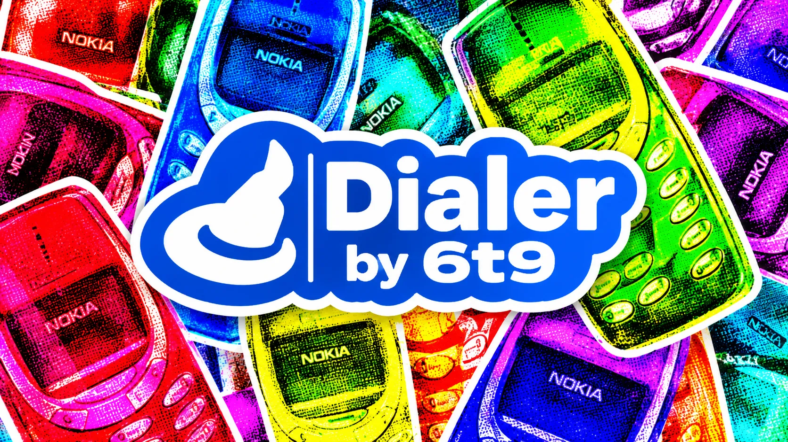

<div align="center">

<a href="https://dailer.apexsofteck.com"></a>

# Open Cold Dialer

### Self-hosted cold calling software. Your server, your SIP provider, no per-seat fees.

A browser softphone with lead management, campaigns, call scripts and call logs, installed on your own server and connected to any SIP provider.

[](https://dailer.apexsofteck.com)
[](mailto:mtaimoormalik99@gmail.com?subject=Open%20Cold%20Dialer%20-%20Source%20code%20and%20setup)
[](https://dailer.apexsofteck.com/docs/)


**[Get the source](#-get-the-full-source-code)** · **[Features](#-features)** · **[Compare](#-why-open-cold-dialer)** · **[How it works](#-how-it-works)** · **[FAQ](#-faq)** · **[Contact](#-contact)**

</div>

---

## 📩 Get the full source code

The complete source code is sent to you by email, together with a done-for-you installation.

> **You pay a one-time fee for setup and SIP configuration. There are no monthly per-user charges.**

<table>
<tr>
<td width="50%" valign="top">

### 📦 What you get

- ✅ **Full source code:** React frontend, Express + SQLite backend, Docker files and database scripts
- ✅ **Installation** on your VPS, Hostinger or local server
- ✅ **SIP configuration** with your provider
- ✅ **Handover:** admin account, an app walkthrough and the docs

</td>
<td width="50%" valign="top">

### 🧾 How to order

1. **Email [mtaimoormalik99@gmail.com](mailto:mtaimoormalik99@gmail.com?subject=Open%20Cold%20Dialer%20-%20Source%20code%20and%20setup)** with:
   - your team size
   - where to host it (VPS, Hostinger, local)
   - your SIP provider, or "help me choose"
2. **Get a quote** for setup and SIP configuration.
3. **Receive the code** and a working, connected dialer.

</td>
</tr>
</table>

<div align="center">

**[📧 Email us for the source code](mailto:mtaimoormalik99@gmail.com?subject=Open%20Cold%20Dialer%20-%20Source%20code%20and%20setup)** &nbsp;·&nbsp; **[📝 Use the contact form](https://dailer.apexsofteck.com/contact/)**

</div>

---

## ✨ Features

<table>
<tr>
<td width="33%" valign="top">

**📞 Browser softphone**<br>
SIP.js over WebRTC. No desktop app, no plugins.

</td>
<td width="33%" valign="top">

**🔌 Any SIP provider**<br>
SignalWire, Telnyx, Twilio, Asterisk, FreeSWITCH or your own server.

</td>
<td width="33%" valign="top">

**👥 Lead management**<br>
Create, search and filter by status. Import from CSV.

</td>
</tr>
<tr>
<td valign="top">

**🎯 Campaigns**<br>
Create and track outbound calling campaigns.

</td>
<td valign="top">

**📜 Call scripts**<br>
Templates with objection-handling responses beside the dialer.

</td>
<td valign="top">

**🕒 Call history**<br>
Every call logged with outcome, duration and notes.

</td>
</tr>
<tr>
<td valign="top">

**📊 Live dashboard**<br>
Real-time stats on leads, calls and conversion rates.

</td>
<td valign="top">

**🔐 Auth and roles**<br>
User accounts with role-based access and JWT sessions.

</td>
<td valign="top">

**🗄️ Self-hosted backend**<br>
Express and SQLite on your server, or optional Supabase.

</td>
</tr>
<tr>
<td valign="top">

**🐳 Docker ready**<br>
One command brings up the full stack.

</td>
<td valign="top">

**🧩 REST API**<br>
Connect leads, calls and scripts to your CRM and tools.

</td>
<td valign="top">

**🧪 Simulated mode**<br>
Try every screen before a SIP provider is connected.

</td>
</tr>
</table>

---

## 💸 Why Open Cold Dialer?

| | **Open Cold Dialer** | RingCentral | Dialpad | Five9 |
|---|:---:|:---:|:---:|:---:|
| Price | **One-time setup fee** | $30/user/mo | $25/user/mo | $150+/user/mo |
| Self-hosted | ✅ | ❌ | ❌ | ❌ |
| Full source code | ✅ | ❌ | ❌ | ❌ |
| SIP provider | **Any** | Locked | Locked | Locked |
| Browser-based | ✅ | ✅ | ✅ | ✅ |
| Lead management | ✅ | Extra | Extra | Extra |
| CSV import | ✅ | ❌ | ❌ | ✅ |
| Call scripts | ✅ | ❌ | ❌ | ✅ |

<sub>Competitor prices are per user per month. Check each vendor for current pricing.</sub>

**Example:** a 10-agent team on a $30/user/month dialer pays **$3,600 a year**, every year. With Open Cold Dialer you pay setup once, plus your SIP provider's call rates, which every dialer needs.

---

## ⚙️ How it works

```
 ┌──────────────┐    WebRTC / WSS    ┌──────────────────┐     SIP      ┌──────────────────┐
 │   Browser    │ ─────────────────▶ │  Your SIP        │ ───────────▶ │  Phone network   │
 │ React+SIP.js │ ◀───────────────── │  provider        │ ◀─────────── │  (your lead)     │
 └──────┬───────┘                    └──────────────────┘              └──────────────────┘
        │ REST API (JWT)
 ┌──────▼───────┐
 │ Your server  │  Express + SQLite: leads, campaigns, scripts, call logs
 └──────────────┘
```

1. **We install it** on your server, with Docker or npm.
2. **We connect your SIP provider:** SIP URI, WebSocket URL and caller ID.
3. **Your team starts dialing:** import leads, build campaigns, call from the browser.

---

## 🧰 Tech stack

<div align="center">


</div>

| Layer | Technology |
|---|---|
| Frontend | React 18, Vite, TypeScript, Tailwind CSS |
| Backend | Express.js, SQLite (better-sqlite3) |
| Auth | JWT (bcryptjs) |
| Telephony | SIP.js (WebRTC) |
| Data fetching | TanStack React Query |
| Validation | Zod |
| CSV import | PapaParse |

---

## 🗺️ Roadmap

- [x] Browser softphone, any SIP provider
- [x] Leads, CSV import, campaigns, call scripts, call history
- [x] Dashboard, auth and roles, REST API, Docker
- [ ] Audio device selector (microphone and speaker)
- [ ] Call recording
- [ ] Parallel dialing (power dialer)
- [ ] Voicemail detection
- [ ] Do-not-call list management
- [ ] Appointment scheduling
- [ ] Webhook integrations
- [ ] AI call summaries

See the full **[roadmap](https://dailer.apexsofteck.com/roadmap/)**.

---

## ❓ FAQ

<details>
<summary><b>What does the fee cover?</b></summary>
<br>
A one-time payment for installation on your server and configuration of your SIP provider. You also receive the full source code. There are no per-user or monthly charges from us.
</details>

<details>
<summary><b>Are there other costs?</b></summary>
<br>
Your hosting (a VPS or Hostinger plan) and your SIP provider's call rates. Every dialer needs a phone carrier, and with Open Cold Dialer you choose it.
</details>

<details>
<summary><b>Which SIP providers work?</b></summary>
<br>
Any provider with WebSocket (WSS) support, including SignalWire, Telnyx, Twilio, Asterisk and FreeSWITCH.
</details>

<details>
<summary><b>Do agents need to install anything?</b></summary>
<br>
No. The softphone runs in the browser. Agents need a microphone, and headphones are recommended.
</details>

<details>
<summary><b>Where is my data stored?</b></summary>
<br>
On your own server, in SQLite. Supabase is available if you prefer a managed database.
</details>

---

## 📬 Contact

<div align="center">

**Ready to stop paying per seat?**

[](mailto:mtaimoormalik99@gmail.com?subject=Open%20Cold%20Dialer%20-%20Source%20code%20and%20setup)
[](https://dailer.apexsofteck.com)
[](https://dailer.apexsofteck.com/contact/)

If this project interests you, please ⭐ **star the repository**.

<sub>Dialer by 6t9 · Apex Softeck</sub>

</div>
